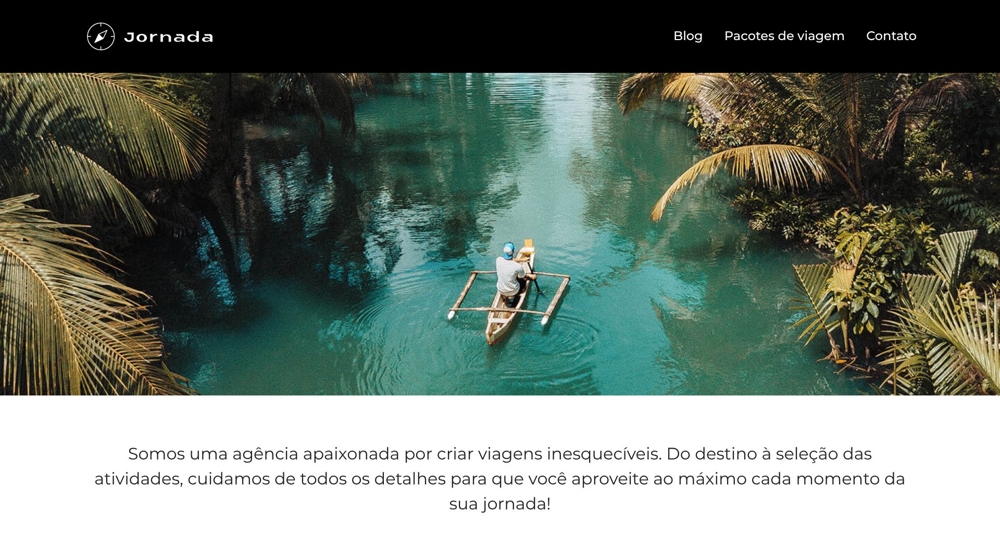

# ✈️ Jornada Viagens

Site desenvolvido para a Jornada Viagens, uma agência fictícia apaixonada por criar viagens inesquecíveis — do destino à seleção das atividades, cuidando de cada detalhe da jornada do cliente.

Este projeto foi desenvolvido durante o curso de responsividade da formação Front-End da Alura, com foco em construir um site multipáginas totalmente responsivo usando a abordagem **mobile first**.

## 🖼️ Preview

## 🚀 Tecnologias utilizadas

- **HTML5** — estruturação semântica do conteúdo
- **CSS3** — estilização e responsividade (Flexbox, Grid, media queries, variáveis CSS)
- **Git & GitHub** — versionamento de código com branches e pull requests

## 📄 Páginas

- 🏠 **Home** — ofertas da semana, busca por categoria, destinos populares, condições de pagamento e depoimentos
- 🗾 **Pacotes de viagem** — página do pacote para o Japão, com destinos da excursão, pagamento e depoimentos

## 📱 Responsividade

O site foi construído com a abordagem mobile first, partindo do layout para celular e evoluindo para telas maiores com breakpoints em:

- 📱 Mobile (layout base)
- 📱 Tablet (a partir de 768px)
- 💻 Desktop (a partir de 1024px)
- 🖥️ Telas grandes (a partir de 1440px e 1920px)

Além disso, as imagens mudam de acordo com o tamanho da tela (versões mobile, tablet e desktop), e o menu vira um menu hambúrguer no mobile — feito só com HTML e CSS, sem JavaScript.

## 💡 O que eu aprendi

- Como aplicar a abordagem mobile first na prática
- Uso de media queries com `min-width` para adaptar o layout a cada tela
- Criação de layouts com Flexbox e CSS Grid (como a galeria da seção de pagamento)
- Organização do CSS em arquivos separados por seção e uso de variáveis CSS para cores e pesos de fonte
- Criação de um menu hambúrguer usando apenas HTML e CSS (checkbox + label)
- Boas práticas de SEO com meta tags e Open Graph
- Fluxo de trabalho com Git usando branches (`feat/` e `bugfix/`) e pull requests

## 🔗 Deploy

🌐 [Acesse o projeto online](https://felipeoc12.github.io/jornada-viagens/)

## 👤 Autor

Desenvolvido por **Felipe Corrêa**

